<p align="center">
  
</p>

<h1 align="center">Arcalo Mail</h1>

<p align="center">
  <b>Your mail, on your computer.</b><br>
  A calm, local-first e-mail app for IMAP/SMTP, Microsoft 365, Outlook.com, Gmail and JMAP accounts, from the makers of
  <a href="https://arcalo.mousewerk.de">Arcalo</a>. No telemetry, remote images blocked until you load them.
</p>

<p align="center">
  <a href="https://github.com/MouseWerk/arcalo-mail/actions/workflows/ci.yml"></a>
  <a href="LICENSE"></a>
  
  
</p>

<p align="center">
  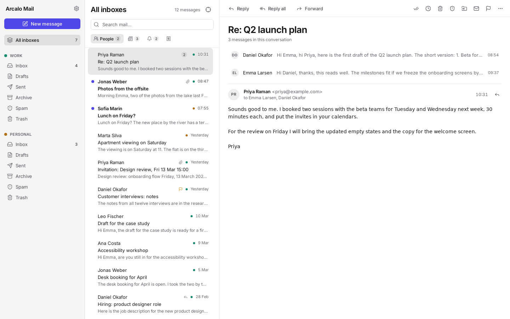
</p>

Arcalo Mail keeps a copy of your mailboxes on your computer and works on that copy: the list opens at once, search
answers while you type, and reading, archiving, flagging and writing go on without a connection. Changes reach the
server in the background, in order, as soon as it can be reached. The app talks to your mail provider and nothing
else, except what you set up yourself (an address book, an AI model) and a few lookups listed under
[Privacy](#privacy).

It works with any IMAP/SMTP provider, signs in to Microsoft 365 and Outlook.com with Microsoft (no password in the
app), guides you to a Gmail app password, speaks JMAP where the provider offers it (Fastmail and others), and
keeps POP3 accounts in folders on your computer.

It speaks English and German and follows your system's language unless you choose one.

## A quick tour

### Three panes, conversations, keys

Folders of all accounts on the left, the list in the middle, the message or the whole conversation on the right.
Unread messages carry a dot, conversations show how many messages they hold, attachments, answers and flags show
in the row. Everything has a key: `j`/`k` to move, `e` to archive, `#` to delete, `r`, `a` and `f` to answer, `s`
to flag, `h` to snooze, `p` to pin, `u` to undo, `c` to write and `/` to search. Archive, delete and move wait five seconds before they reach
the server, so `u` takes them back without a trace.

<p align="center">
  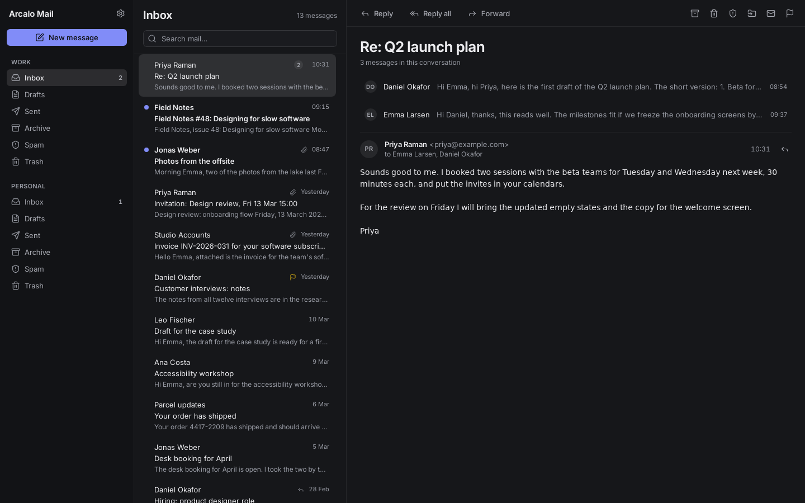
</p>

### An inbox that sorts itself

The inbox comes in tabs: People, Newsletters, Notifications, Receipts and Other, each with its unread count. The
app sorts on your device, from what the header says (mailing list and unsubscribe headers, `Precedence`,
`Auto-Submitted`, machine senders, receipts and orders in German and English); anyone you wrote to is a person.
Move a sender to another tab once and its mail goes there from then on. Pin what must stay on top. Newsletters come
as one row per sender and open as a stream of their issues, one below the other. Focus shows only people and
pinned messages, and only they notify you. With two accounts or more, "All inboxes" opens first, with a colored
dot for each account. Done (`e`) archives, and an empty inbox says so, calmly.

<p align="center">
  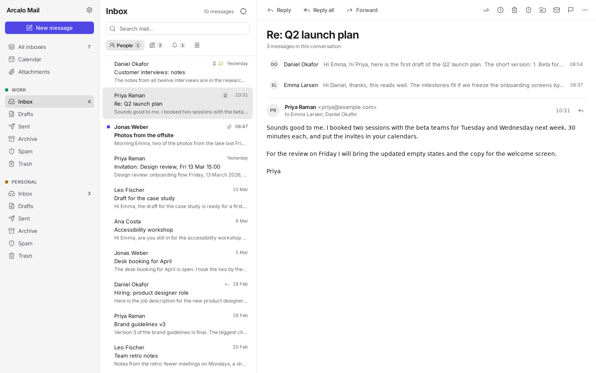
</p>

<p align="center">
  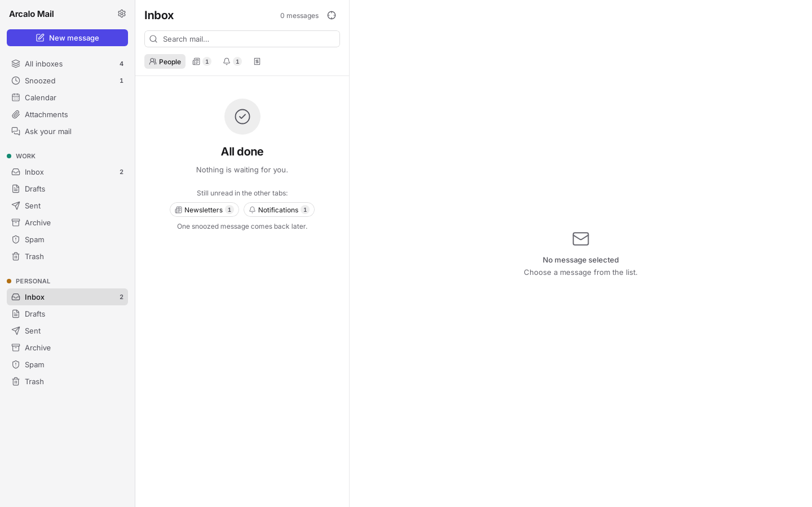
</p>

### New senders and subscriptions

The Screener is off unless you switch it on, in the setup or in the settings. Then mail from people who never
wrote to you waits under "New senders" until you let the sender in or turn it away once; contacts and replies to
your messages always come through. Mail of a sender you turned away goes to a "Screened Out" folder on the server,
now and later; nothing is deleted. Subscriptions lists every sender you can unsubscribe from: one click where the
sender supports it (RFC 8058), otherwise the e-mail the list asks for, or its web page after you confirm.

<p align="center">
  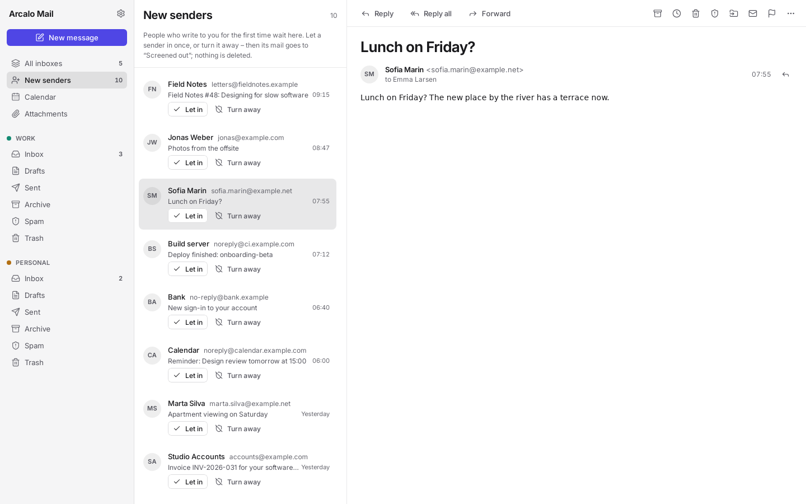
</p>

<p align="center">
  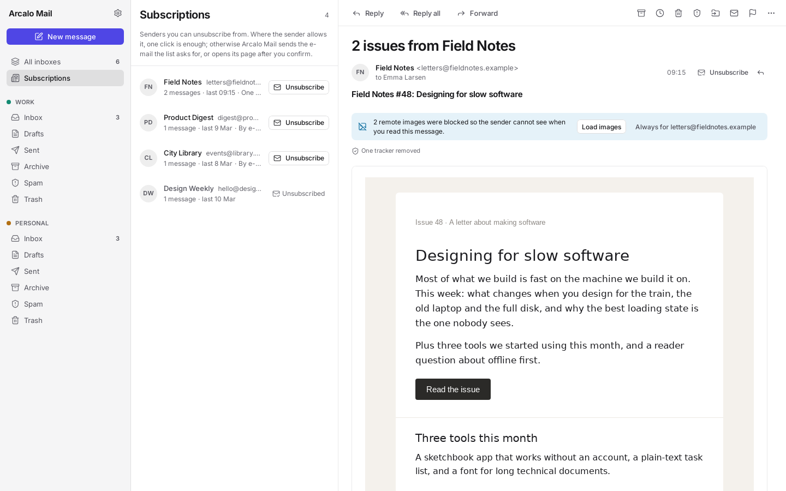
</p>

### Later, not now

Snooze a message until later today, tomorrow, the weekend, next week or a time you pick (`h`): it waits in a
"Snoozed" folder on the server, so other apps see it out of the inbox too, and comes back unread at the top. Write
now and send later: the message waits in the app and goes out at its time (on a computer that was off then, at the
app's next start; on a phone with the next background check). "Remind me if no answer" brings a message back when
nobody answered by then. "Read later" keeps a list of what you put aside.

<p align="center">
  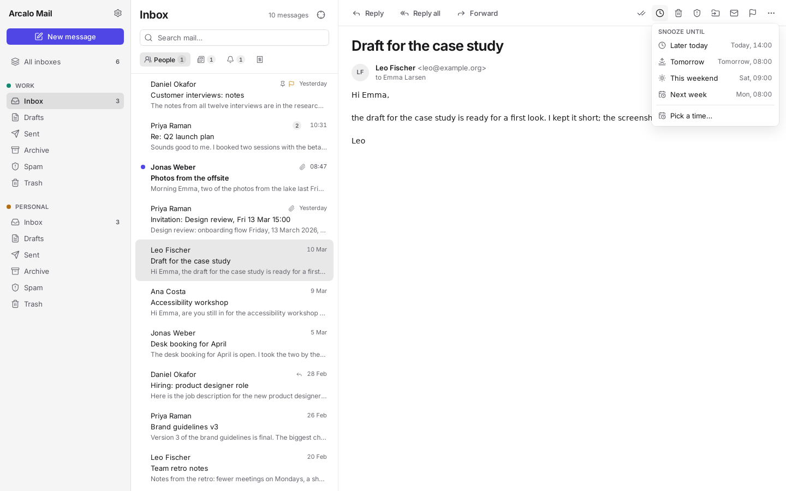
</p>

### HTML mail without the tracking

HTML mail is cleaned before it is shown (no scripts, forms, frames or style sheets) and drawn in a sandboxed frame
with its own content security policy. Remote images are blocked, so senders do not learn when you read their mail;
one click loads them for this message, another for every message of that sender. Tracking pixels and link trackers
(click redirects, `utm_` and similar parameters) are removed from every message, also when images load, and the
message says how many; no request ever goes to them. Quoted text is folded away, and every HTML message can also be
read as plain text.

<p align="center">
  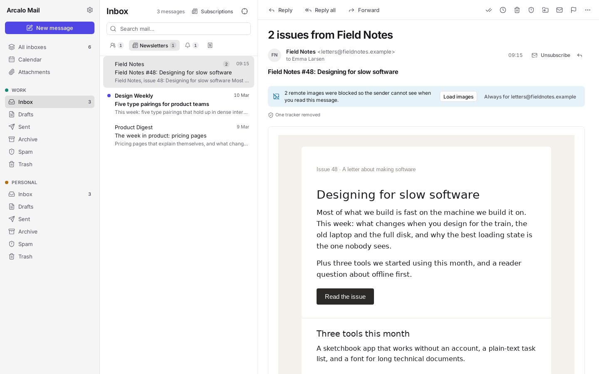
</p>

### Writing

New messages, replies with the quote below and forwards with the original attachments open in a sheet next to what
you are reading. Recipients complete from everyone you have written with or heard from; drop files on the sheet to
attach them. Rich text or plain text, a signature per account, drafts saved to the server's Drafts folder, and five
seconds to take a message back after pressing Send. Sent mail is filed in Sent, except where the provider does that
itself, as Gmail does.

<p align="center">
  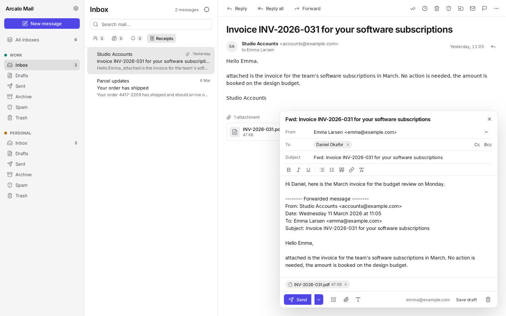
</p>

### Search

Search runs on the local copy while you type: subjects, people and the text of every fetched message, newest first,
with accents and umlauts matched either way. For older mail whose text is still only on the server, "Search on the
server" asks the server and adds what it finds.

<p align="center">
  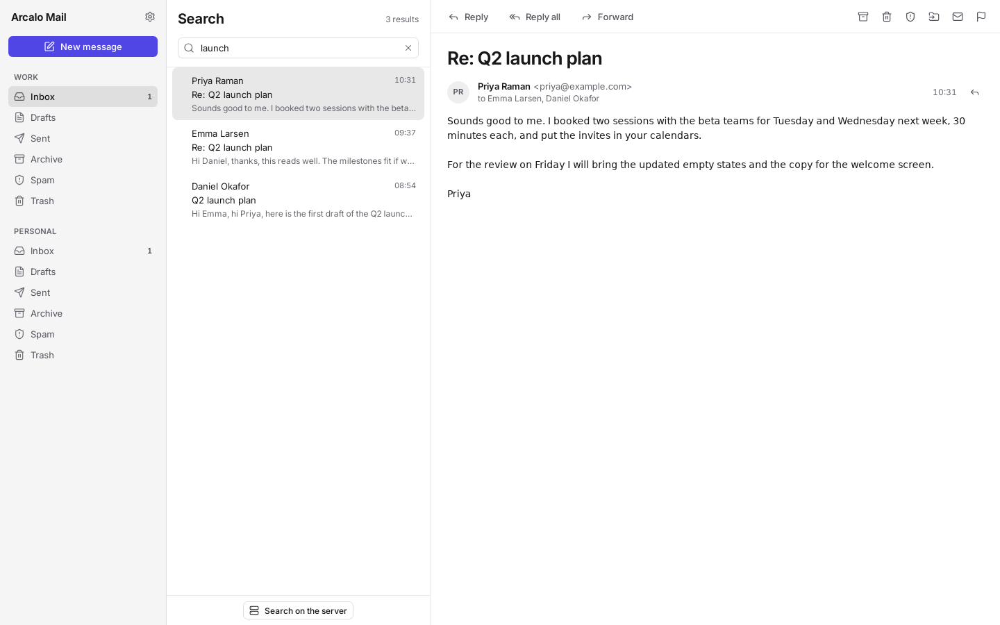
</p>

### The assistant

An assistant that you switch on by setting up a model: one on your computer (Ollama, LM Studio, or any server that
speaks the OpenAI chat protocol), or a cloud provider you add yourself (OpenAI, Anthropic, Mistral, Azure OpenAI).
Until then it is off, and nothing about it shows. Every account chooses which provider may see its mail; a cloud
provider is never chosen for you, and a line under the buttons always says where the text goes ("Stays on this
device · Ollama" or the cloud provider's address).

Above a message: a summary of the conversation (by itself for long ones), a reply draft in your own tone (learned on
your computer from your sent mail: greeting, closing, formal or informal, a few short samples) that opens in the
compose sheet, a translation, and the tasks and dates in it, each one a reminder or an entry for your calendar app.
In the compose sheet the writing help makes your text shorter, friendlier, more formal (in German the "Sie" form)
or fixes spelling and grammar, and you apply or discard the result. "Ask your mail" answers questions from your
mail: the local search finds the messages, the model reads them, and every answer links to its sources. New mail
from people who need something from you can be marked "Important". Answers stream in as they are written, can be
stopped at any time, and come in your language; when a model is not reachable or refuses a key, the app says so.

<p align="center">
  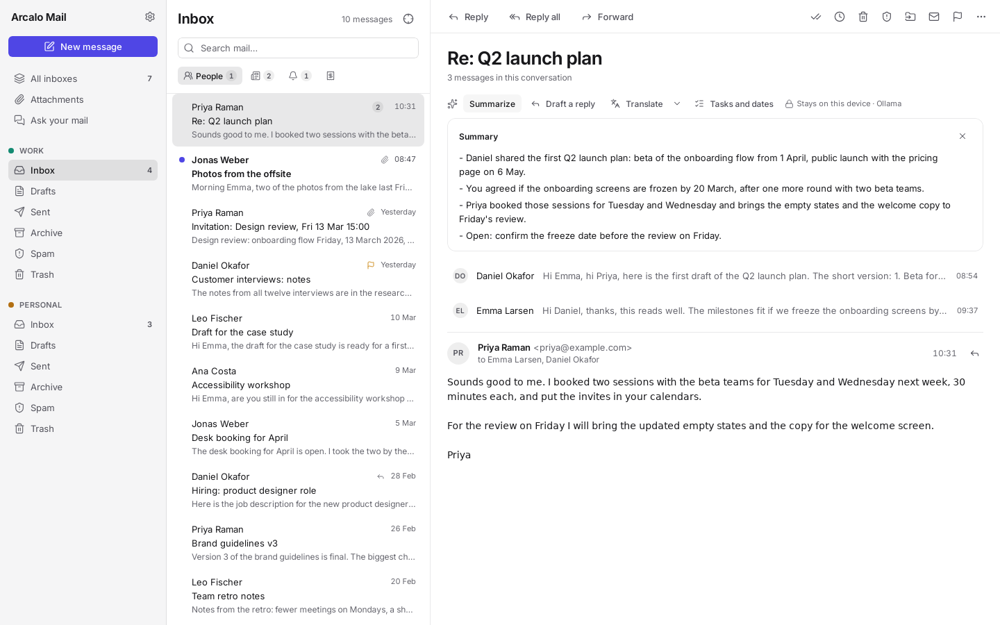
</p>

<p align="center">
  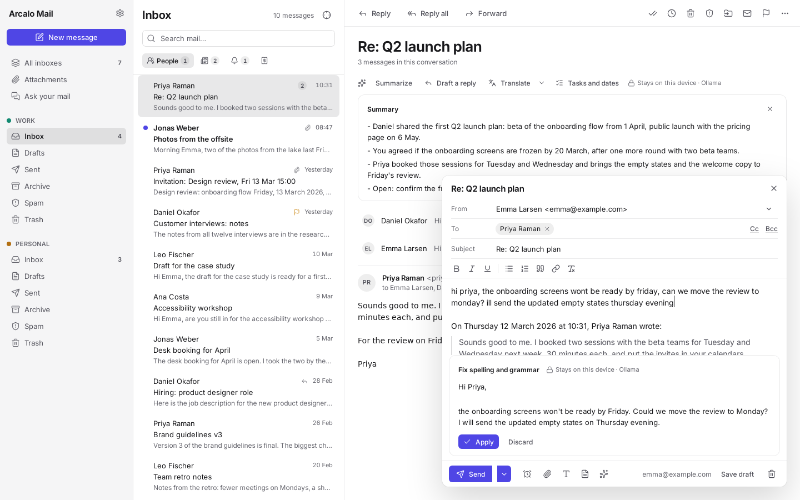
</p>

### Rules

Rules sort new mail: conditions on sender, recipients, subject, mailing list, attachments, size, age and the
inbox tab; actions that move, label, mark read, flag, pin, forward, delete, skip the inbox or set the tab. They run
in a set order and can be switched off one by one. A preview shows which messages on your computer match, and
"Run now" applies a rule to a folder. A rule runs in the app, or on the server so it works while the app is
closed: as a Sieve script over ManageSieve (RFC 5804) for IMAP providers that offer it, and as an inbox rule of
Microsoft 365 and Outlook.com. Your own Sieve rules on the server stay as they are.

<p align="center">
  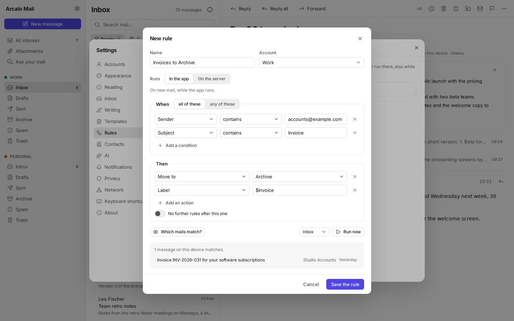
</p>

### Templates and snippets

Templates fill a new message with a subject and a text; snippets come in while you write: type `;;` and the start of
a shortcut, and pick one. Both know placeholders for the recipient's name and first name, the date, the time, your
name, the subject and the account's signature (which never ends up twice).

### Contacts and pictures

Address books over CardDAV (iCloud, Fastmail, mailbox.org, Posteo, Nextcloud and other servers) and the contacts of
Microsoft accounts are kept on your computer and complete addresses as you type, next to everyone you have written
with. Senders show their picture from your address book, or the logo a company publishes for its domain (BIMI),
otherwise their initials; Gravatar is there to switch on. Pictures never come from inside a message. A click on a
sender opens the contact card: addresses, phone and company, the recent mail with them, the files they sent, and
"New message".

<p align="center">
  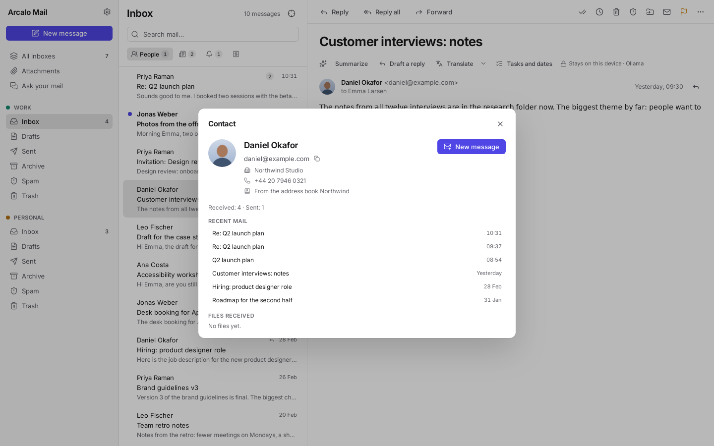
</p>

### Attachments

"Attachments" lists every file of your mail in one place, newest first, filtered by kind, sender, time and name.
Pictures and text files open in a preview, everything else in its program; each one saves with a click and leads to
its message.

<p align="center">
  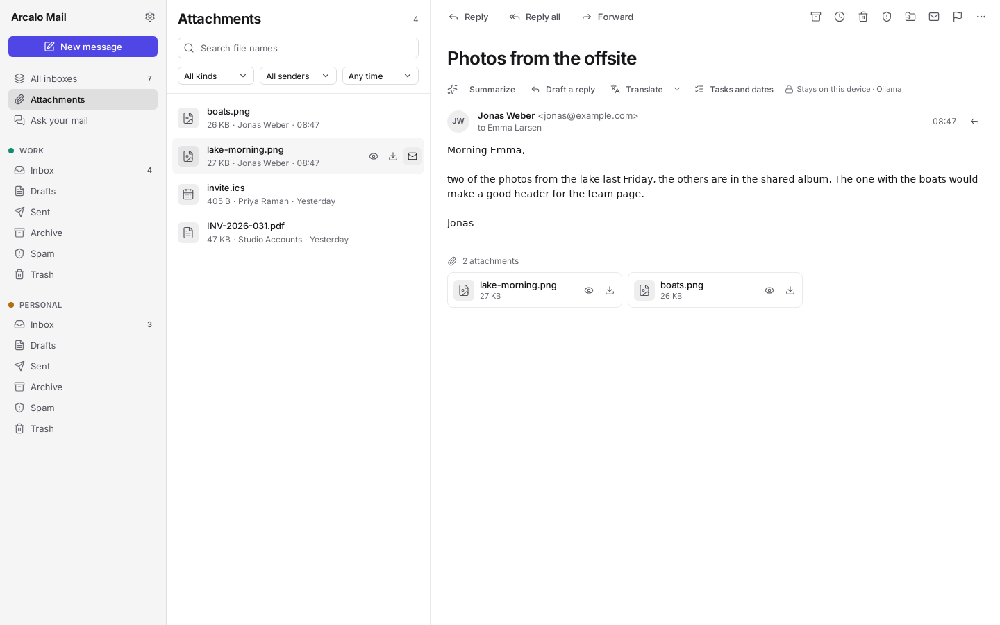
</p>

### Adding an account

Enter your name, address and password. Arcalo Mail looks up the servers itself: presets for common providers (GMX,
WEB.DE, T-Online, mailbox.org, Posteo, iCloud, IONOS, STRATO, Gmail, Fastmail, Yahoo and others), the provider's
own autoconfig file, the Thunderbird provider database, DNS records and JMAP at the provider's well-known address.
Then it signs in and says plainly what went wrong if something did: a wrong password, a provider that wants an app
password or IMAP switched on first, an unknown certificate (with its fingerprint to compare and trust), a server
that does not answer. Everything can also be set up by hand: IMAP/SMTP, JMAP, or POP3/SMTP. A POP3 account keeps
its folders on your computer and leaves the mail on the server (for a number of days, or until you delete it
there) unless you choose otherwise.

<p align="center">
  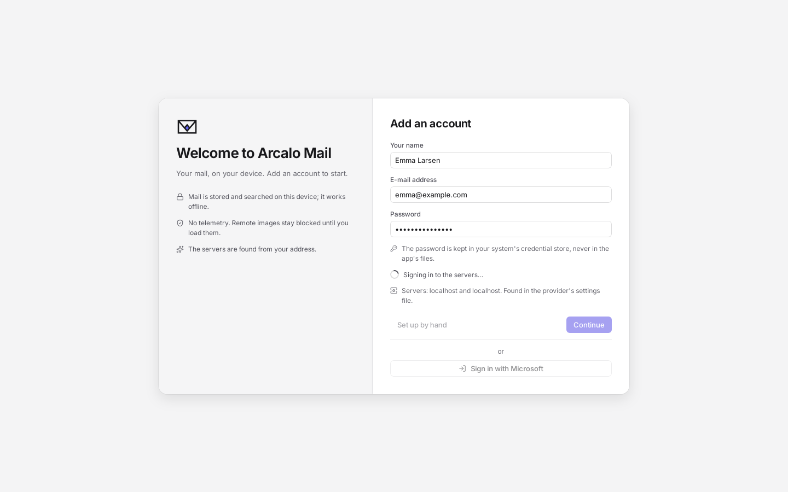
</p>

### Microsoft 365 and Outlook.com

Microsoft accounts sign in with Microsoft: Arcalo Mail opens Microsoft's sign-in page in your browser, you sign in
there and allow access to your mail, and the app continues on its own. Your password never reaches the app; it
keeps a sign-in token in your system's credential store and uses IMAP and SMTP with OAuth (XOAUTH2). Addresses at
outlook.com, hotmail.com and live.com go there directly, Microsoft 365 domains are recognized by their mail
servers, and the button works for any other. When an organization has not approved the app yet, or has switched
off sending over SMTP for the mailbox, the app says so and what IT can do (details in
[docs/microsoft.md](docs/microsoft.md)).

<p align="center">
  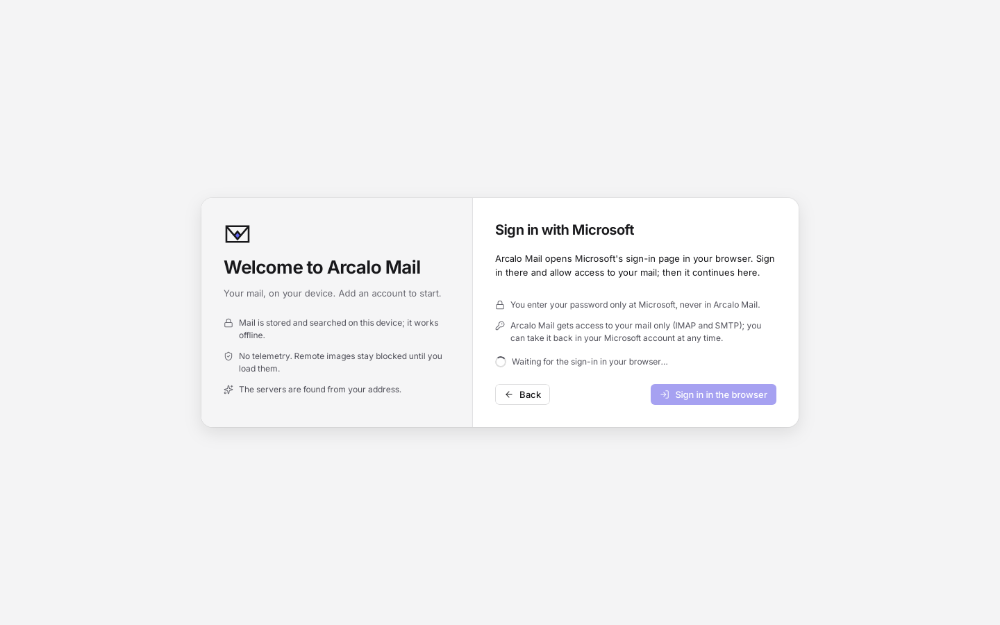
</p>

### Gmail

Until signing in with Google arrives, Gmail and Google Workspace work over IMAP with an app password. For a Gmail
address the setup shows how to make one (2-Step Verification on, then the app passwords of your Google account) and
opens the page for you. Labels show as folders; All Mail, Starred and Important are not downloaded twice, search
shows each message once, archiving takes a message out of the inbox, and Gmail files sent mail itself.

<p align="center">
  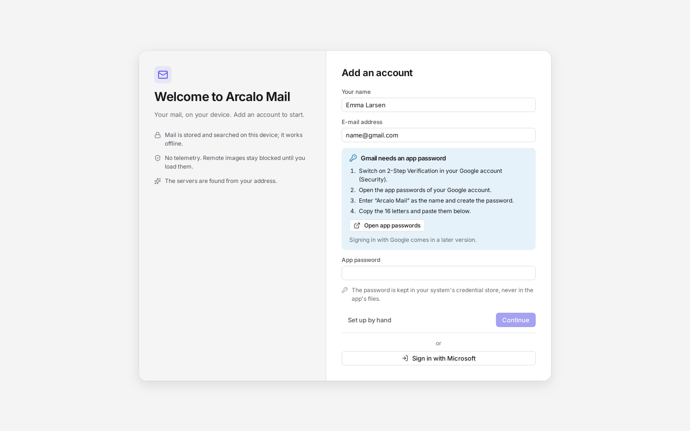
</p>

### JMAP

Where the provider offers JMAP (Fastmail, Stalwart, Cyrus and others), Arcalo Mail uses it instead of IMAP: one
connection over HTTPS, changes since the last visit in one request, new mail pushed the moment it arrives. It signs
in with the password (or app password) or an API token. A JMAP account behaves like any other: offline, search,
the outbox, undo.

### Settings, themes and small windows

Settings apply at once: accounts with their name, sender name, signature and servers; a light, dark, high-contrast
or the system's theme; conversations and preview lines; what is downloaded ahead; notifications for new mail;
remote images and the senders you trust; proxy profiles. `Ctrl+K` (`Cmd+K` on a Mac) opens the command palette:
every command and every folder, a few keys away. The layout holds up from 900 pixels wide.

<p align="center">
  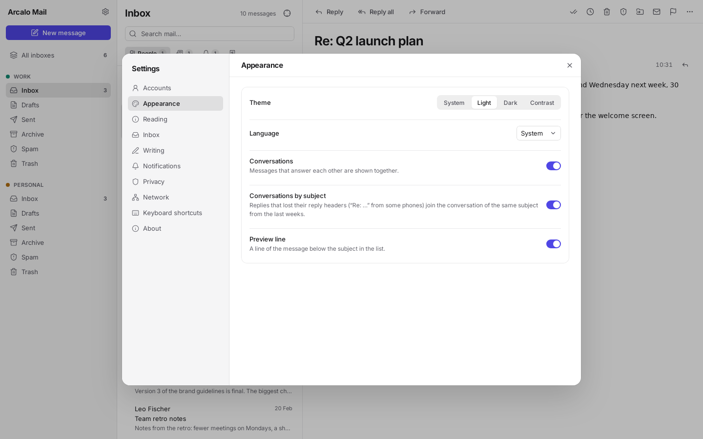
</p>

<p align="center">
  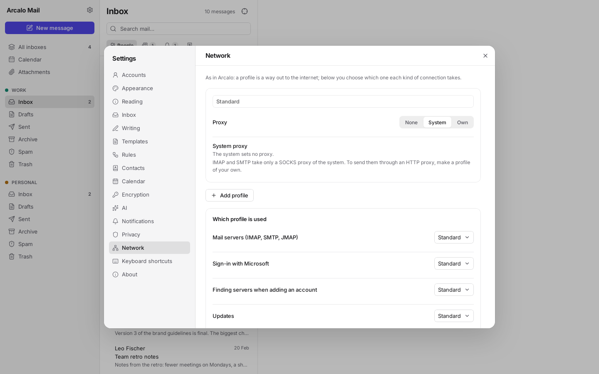
</p>

<p align="center">
  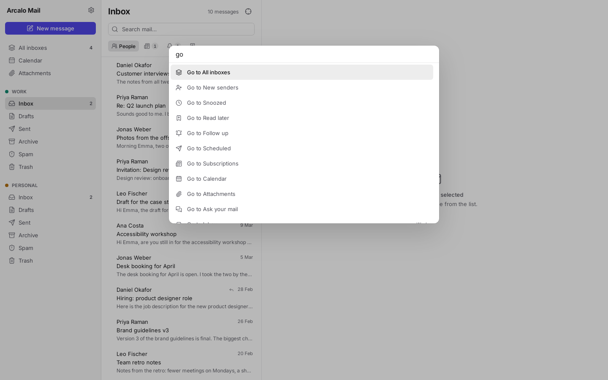
</p>

<p align="center">
  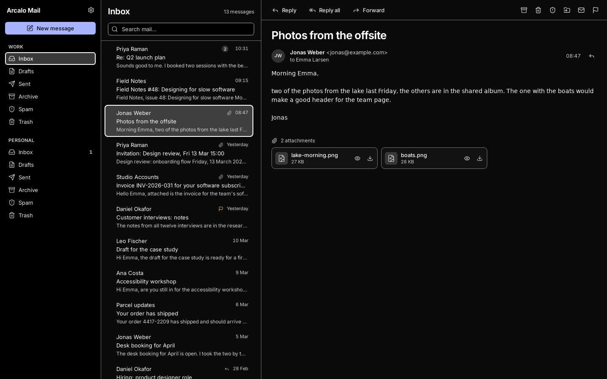
</p>

<p align="center">
  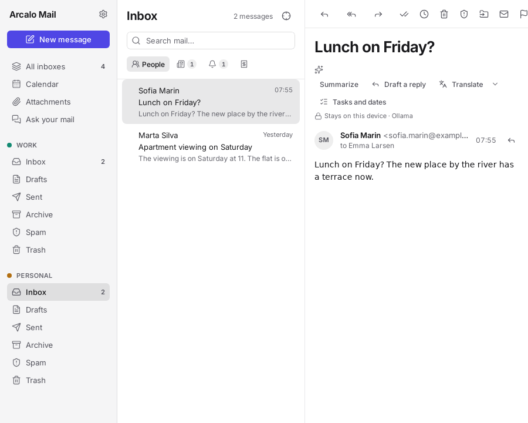
</p>

### Phones and tablets

On a phone the folders, the list and the message take the screen one at a time; on a tablet the list and the
message sit side by side and the folders slide in. A swipe over a message archives it or marks it read (you choose
what each side does), pulling the list down checks for mail, and the message's actions sit at the bottom, in reach
of the thumb. Microsoft accounts sign in through the system's browser. New mail arrives while the app is open; in
the background the phone checks now and then (Android about every 15 minutes, iOS when the system allows) and
tells you, without a server of ours in between.

<p align="center">
  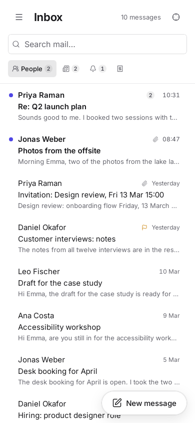
  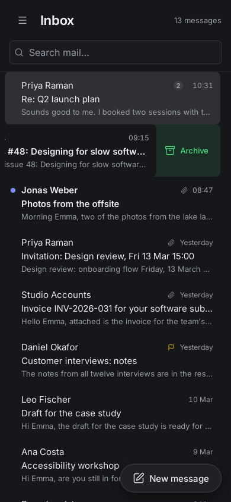
  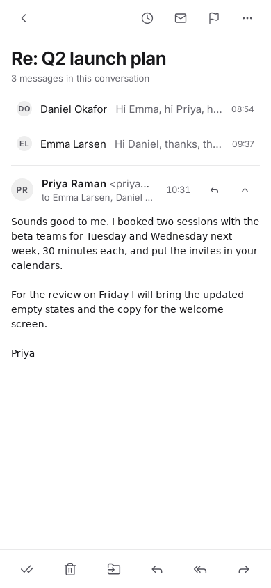
</p>

<p align="center">
  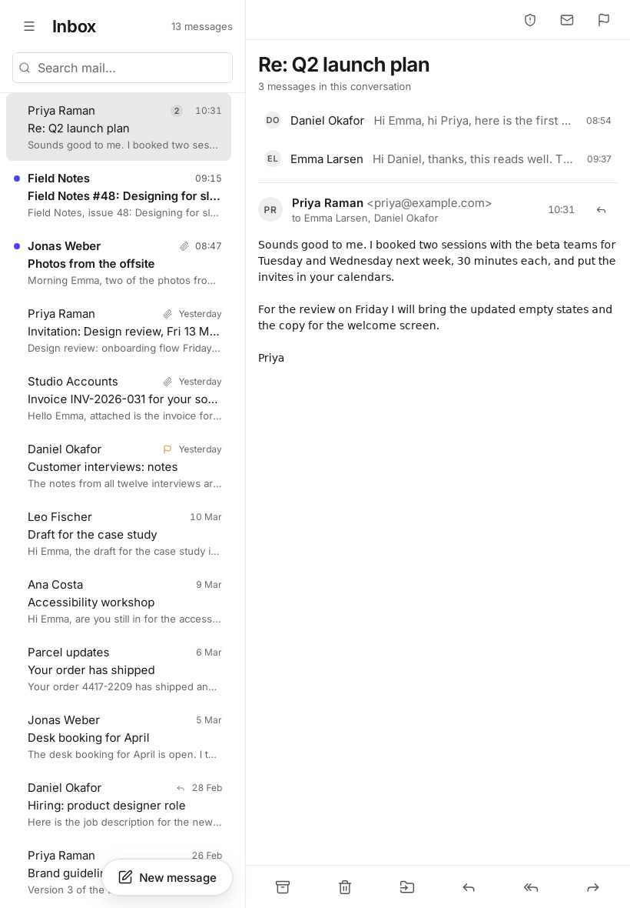
</p>

## Features

- **Accounts:** any IMAP/SMTP provider with TLS or STARTTLS; Microsoft 365 and Outlook.com with Microsoft sign-in
  (OAuth 2.0 with PKCE, XOAUTH2); Gmail and Google Workspace with an app password; JMAP with push; POP3 (RFC 1939,
  with TLS or STLS and UIDL) with local folders and SMTP. Several accounts side by side, each with its own
  connection.
- **Sync:** new mail through IMAP IDLE or JMAP push; only what changed since the last visit where the server supports
  QRESYNC, CONDSTORE or JMAP changes; folder roles from the server (Inbox, Drafts, Sent, Archive, Spam, Trash);
  reconnects at once after sleep or a network change, and with growing pauses while the network is gone.
- **Network:** proxy profiles as in Arcalo (none, the system's, or an HTTP or SOCKS5 proxy with exceptions), chosen
  per kind of connection: mail servers, sign-in, the setup's lookups.
- **Offline:** reading, searching and every action work without a connection; changes and messages wait in the
  Outbox and go out in order when the server is back. The newest messages of each folder (or all of the last 30
  days) are fetched ahead, large ones and attachments when you open them.
- **Conversations:** by the reply headers, and replies that lost them by their subject.
- **Sorted inbox:** tabs for people, newsletters, notifications, receipts and other, sorted on the device from the
  headers; senders moved to another tab stay there; newsletter bundles; focus; pin; the unified inbox of all accounts.
- **Screener and subscriptions:** first-time senders wait until let in (off by default); turned-away senders go to
  "Screened Out"; one-click unsubscribe (RFC 8058), by e-mail, or the list's page after you confirm.
- **Time tools:** snooze (synced through a "Snoozed" folder), send later, reminders when no answer came, read later,
  done and inbox zero.
- **Tracker protection:** tracking pixels and link trackers removed from every message, counted per message.
- **Folders:** create, rename and delete folders; move messages by menu or key; spam and archive with one key.
- **Assistant (optional):** summaries, reply drafts in your tone, writing help, translation, tasks and dates, questions
  to your mail with sources, "Important"; local models (Ollama, LM Studio, OpenAI-compatible) or a cloud provider
  per account; streamed, stoppable, off until set up.
- **Rules:** in the app or on the server (Sieve over ManageSieve, Microsoft inbox rules), with preview and "Run now".
- **Templates and snippets** with placeholders and `;;` shortcuts.
- **Contacts:** CardDAV address books and Microsoft contacts, address completion, contact cards, pictures from the
  address book or BIMI (Gravatar optional).
- **Attachments:** all files of your mail in one list, filtered, previewed, saved or opened.
- **Notifications:** a desktop notification for new mail, the unread count on the app icon and in the tray, with
  quick actions there.
- **Diagnostics:** Settings → About exports a text file for a support request: versions, settings, servers and the
  recent connection log, without addresses, messages or passwords.
- **Keyboard and screen readers:** the whole app works with the keyboard, focus stays visible, controls are
  labeled, and there is a high-contrast theme.

## Privacy

- **Local-first.** Your mail is stored in one SQLite database in your user folder and searched there.
- **No telemetry.** The app connects only to the mail servers you set up, Microsoft's sign-in (and Microsoft Graph
  for server rules and contacts) for Microsoft accounts, while you add an account to the lookups that find their
  addresses, to a newsletter's unsubscribe address when you ask for it, and to what is listed below: the AI
  provider and address books you set up, and the BIMI logos of senders' domains. No analytics, no crash upload, no server of ours in between. Sorting, the Screener
  and the time tools run on the device.
- **Remote content blocked.** Images from the internet load only when you say so, for one message or one sender.
  Tracking pixels never load, and links lose their trackers.
- **The assistant** is off until you set up a provider, and each account decides which provider may see its mail
  (a provider on your computer is used for accounts without a choice of their own; a cloud provider only for the
  accounts you choose it for, and never for "Ask your mail" across other accounts). What goes to the provider, and
  only when you ask for it, except where noted:
  - *Summary:* sender, date, subject and text of each message of the conversation (up to 4,000 characters each,
    16,000 in all), without quoted text and signatures. Long conversations (four messages or more, or 3,000
    characters) are summarized when you open them unless you switch "Summaries by themselves" off.
  - *Reply draft:* the same, plus your notes for the reply and your tone: greeting, closing, formal or informal, and
    up to three short samples (280 characters each) of your sent mail.
  - *Writing help:* only the text you wrote, without the quote and the signature.
  - *Translation, tasks and dates:* one message (sender, date, subject, text, without quote and signature); for
    tasks also today's date.
  - *Ask your mail:* your question and up to eight messages the local search found (sender, date, subject, up to 900
    characters of text), only from accounts that provider may see.
  - *Important:* with "Mark important mail" on (the default once a provider is set up), up to five new messages per
    check (sender, date, subject, up to 2,000 characters of text) go to the account's provider in the background.
  - Nothing else: no address book, no settings, no other messages. Answers are kept in the local database so
    nothing is asked twice (Settings → AI → "Kept answers" forgets them); the tone is learned and kept on your computer.
    Over plain HTTP the app only talks to a model on your own computer; anything else takes HTTPS. API keys are kept
    in the credential store.
- **Contacts and pictures.** Address books are read from the servers you add (CardDAV) or from Microsoft (Microsoft
  Graph, with the sign-in's permission to read contacts). For a sender's logo the app looks up the domain's BIMI
  record in the DNS once, and if the domain enforces DMARC fetches the logo from the address in that record, checks
  that it is a plain SVG Tiny picture and keeps it; switch this off in Settings → Contacts. Gravatar is off by
  default; when on, it receives a hash of the sender's address. Pictures in a message are never used.
- **Server rules** go to your mail provider only: as a Sieve script over ManageSieve, or as inbox rules over
  Microsoft Graph for Microsoft accounts (with the sign-in's permission to change mailbox settings).
- **Unsubscribing** is the one request to a sender's web address, and only when you click "Unsubscribe": a single
  POST that says nothing about you but the unsubscribe itself (RFC 8058).
- **Passwords and sign-in tokens** are kept in your system's credential store (Windows Credential Manager, the
  macOS and iOS keychain, the Secret Service on Linux; on Android encrypted with a key of the Android Keystore), never
  in the database, the settings or a log. On a Linux desktop without a keyring they go to a file only your user can
  read, and the settings say so.

## Platforms

| Platform | Status |
|---|---|
| Windows 10/11 | builds in CI (unsigned installer) |
| macOS 11+ | builds in CI (ad hoc signed) |
| Linux (deb, AppImage) | builds in CI; the end-to-end tests run here |
| Android 7+ | builds in CI (APK, and the AAB for Google Play once the release key is set up) |
| iOS 14+, iPadOS | the Rust part builds in CI; TestFlight and the App Store once the Apple account is set up |

## Install

There is no release yet. Installers for Windows, macOS and Linux will be attached to the
[releases](https://github.com/MouseWerk/arcalo-mail/releases) with the first version; until then, build from source.

## Build from source

Requirements: Rust (the version in `rust-toolchain.toml` is picked automatically), Node.js 22, and the Tauri
prerequisites of your platform (<https://tauri.app/start/prerequisites/>): WebView2 on Windows, the Xcode command
line tools on macOS, `libwebkit2gtk-4.1-dev` and friends on Linux.

```
npm --prefix ui install
cargo install tauri-cli --version "^2" --locked

# Development: the app with the Vite dev server
cd src-tauri && cargo tauri dev

# Release build (installers in target/release/bundle)
cd src-tauri && cargo tauri build
```

Only the UI, with sample data in the browser: `npm --prefix ui run dev` and open <http://127.0.0.1:1420>.

Tests:

```
cargo test -p mail-core -p mail-testserver -p arcalo-mail
npm --prefix ui run typecheck && npm --prefix ui test

# End-to-end on Linux: the real app against an IMAP/SMTP test server on this computer
npm ci --prefix e2e && e2e/run.sh
```

`crates/mail-testserver` is a small IMAP, SMTP and JMAP server for tests with an OAuth identity provider (its
options are listed at the top of `src/main.rs`); no local test talks to a real mail server. In CI a conformance
job also runs the client against Dovecot and GreenMail containers
(`cargo test -p mail-testserver --test conformance -- --ignored`, see `tests/conformance.rs`).

A build signs in to Microsoft only with a client id: `ARCALO_MAIL_MS_CLIENT_ID=… cargo tauri build`
([docs/microsoft.md](docs/microsoft.md)). The screenshots above come from `cd e2e && npm run shots`,
with made-up people on reserved example domains.

More: [docs/ARCHITECTURE.md](docs/ARCHITECTURE.md), [docs/plan.md](docs/plan.md), [docs/microsoft.md](docs/microsoft.md),
[docs/i18n.md](docs/i18n.md).

## License

MIT, see [LICENSE](LICENSE). Copyright MouseWerk, Maurice Kleindienst.
